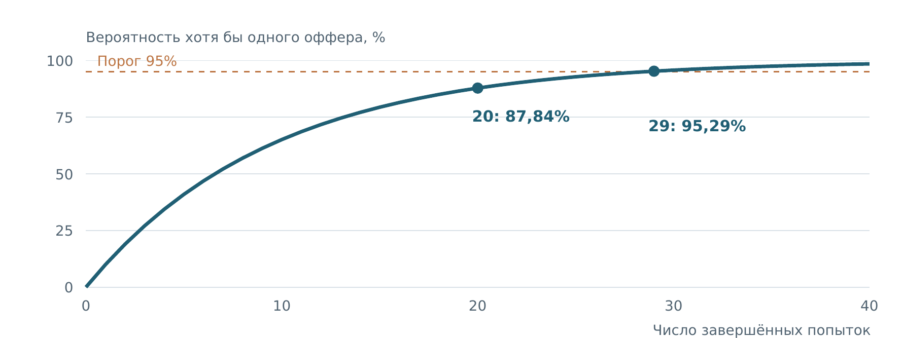
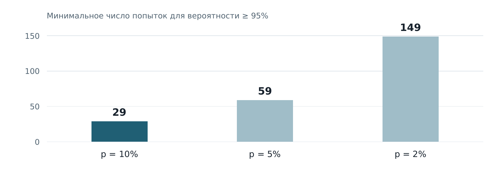

## Проверка выводов о трудоустройстве

**Главный результат:** при постоянной конверсии 10% и независимых попытках 20 завершённых попыток дают **87,84%** вероятности хотя бы одного оффера. Для достижения 95% нужно минимум **29 попыток**.



### Что я хотел выяснить
В учебном задании я проверял несколько утверждений об эффективности курса и шансах получить оффер. Меня интересовало, какие выводы следуют из чисел, а где для вывода не хватает данных.

### Что я сделал
- Разграничивал долю респондентов и результат всей исходной группы.
- Проверял направление условной вероятности и отделял связь от причинности.
- Задавал допущения модели, рассчитывал вероятность успеха и чувствительность к конверсии.
- Переводил расчёт в практические рекомендации по измерению этапов поиска.

### Проверка исходных утверждений
Из 500 учеников ответили 200; 156 респондентов сообщили о трудоустройстве. **78% относится к ответившим**, а не автоматически ко всем выпускникам. Без сведений о неответивших общий результат неизвестен.

Утверждение «85% получивших оффер знают SQL и Python» описывает `P(навыки | оффер)`. Для оценки `P(оффер | навыки)` нужны другие данные, в том числе результаты кандидатов с навыками и без них.

### Модель и чувствительность
При независимости и постоянной вероятности успеха `p`:

`P(хотя бы один оффер) = 1 − (1 − p)^n`

| Конверсия одной завершённой попытки | Минимум попыток для вероятности ≥ 95% |
|---:|---:|
| 10% | 29 |
| 5% | 59 |
| 2% | 149 |



### Вывод и ограничения
Высокая расчётная вероятность не гарантирует оффер. При независимости предыдущие отказы не повышают вероятность успеха следующей попытки. В реальном поиске меняются качество откликов, вакансии и этапы отбора, поэтому допущения нужно проверять.

Числа 2%, 5% и 10% — сценарии модели, а не измеренная личная конверсия. Для анализа поиска я предложил фиксировать завершённые процессы, разделять этапы отбора и смотреть не только на средние, но и на медианы и перцентили.

### Как повторить
```bash
python offer_model.py
```
Стандартная библиотека Python. Скрипт сохраняет вероятности для 0–150 попыток в `model-probabilities.csv`. К портфолио я добавил скрипт, чтобы эти расчёты можно было повторить.

---

[← Все кейсы](https://github.com/antonislav11)
